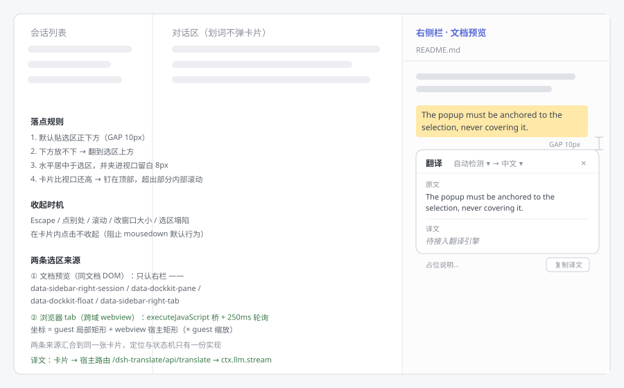

# dsh-translate

右侧栏划词翻译。在**文件树 / 文档预览 / 浏览器 tab** 里用鼠标选中一段文字，选区正下方弹出一张翻译卡片。

译文有**三条引擎路径**：微软翻译（免费端点）、Google 翻译（免费端点）、以及 DSH 已配置的模型。**默认用微软翻译**；点卡片底部的引擎标签会**弹出一个下拉列表**，选哪一家就用哪一家（另有 `自动` = 按 `微软 → Google → 模型` 依次尝试），选择会被记住。

语言也是两个可手动改的下拉：**默认「自动检测 → 中文」**，左边选原文语言、右边选目标语言（72 门语言），两个选择同样会被记住。语言菜单是**紧凑变体**（贴着各自的按钮、宽度按内容、没有说明列），跟底部那个带说明的引擎菜单明显不同。



## 能力

| | 状态 |
|---|---|
| 文档预览（Markdown / 代码 / 文本 / PDF 文字层）里划词 → 卡片贴在选区下方 | ✅ |
| 侧栏浏览器（Electron `<webview>`）里划词 → 同一张卡片 | ✅ 走 `executeJavaScript` 桥，250ms 轮询 |
| **微软翻译**（免费端点，无需 key） | ✅ 默认首选 |
| **Google 翻译**（免费端点，无需 key） | ✅ 需要线路能到该域名（见下） |
| **模型翻译**（ctx.llm.stream） | ✅ 兜底，也是唯一"一定能用"的一路；**跟随当前对话的模型**（读会话请求日志），读不到才退回设置里的全局默认 |
| 三家都失败时**列出每一家的原因**（而不是只说"全都失败了"） | ✅ |
| **源语言可手动指定**（默认「自动检测」，可点开选日语/英语…） | ✅ 会记住，并作为 `from` / `sl` / `fromLang` 传给对应引擎 |
| **目标语言可手动指定**（默认中文，**72 门语言**） | ✅ 会记住 |
| **点引擎标签弹出下拉列表**选引擎（带说明、当前项打勾），选择会被记住（默认微软翻译） | ✅ |
| 切换引擎/语言时**旧译文留在原位**（只有标签变"更新中…"，不闪白、不跳高度），**迟到结果不会顶掉新结果** | ✅ |
| 卡片**跟着选区滚动重定位**；卡片内部滚动不会把它关掉 | ✅ |
| 卡片**始终夹在右侧栏内**（不会越到对话区 —— 越出去的那部分既盖住别处又点不动） | ✅ |
| 在侧栏里划词后，**鼠标移到侧栏外再松手也照样弹**（`mouseup` 走捕获阶段 + 选区稳定兜底） | ✅ |
| 失败可重试；宿主侧结果缓存（按引擎 + 目标语言 + **源语言** 分别缓存） | ✅ |
| 对话区划词**不**打扰；Escape / 点别处 / 滚动 / 改窗口收起 | ✅ |

## 三条引擎路径

```
卡片 ──POST/GET /dsh-translate/api/translate {text,target,engine}──► 宿主 lib/index.js
                                                                      ├─ microsoft → edge.microsoft.com + api-edge…
                                                                      ├─ google    → translate.googleapis.com（gtx 端点）
                                                                      └─ llm       → ctx.llm.stream
```

**为什么三家都放宿主**：页面 origin 是 `dsh-app://app`。模型凭据只允许宿主读取（`deepseekAccount` 的服务描述写得很明确："only Host consumers can obtain a request credential"），而两家传统翻译端点都**不带 CORS 头** —— 从页面直连一定被浏览器拦。走宿主还顺带拿到结果缓存、超时与失败码在一处收口、key 永不进 DOM。

| 引擎 | 免费模式（默认） | 官方模式（配了 key 时） |
|---|---|---|
| 微软 | ① `edge.microsoft.com/translate/auth` 取 JWT（宿主内缓存 8 分钟，401 换一个重试）→ `api-edge.cognitive.microsofttranslator.com`；② ①失败时走 **Bing 网页版**：抓 `cn.bing.com/translator` 拿 `params_AbusePreventionHelper` + `IG` + Cookie（宿主缓存 5 分钟）→ POST `ttranslatev3`。两条通道**共享同一个时间预算**，不会为一个引擎等双份 | Azure Translator（`Ocp-Apim-Subscription-Key` + 可选 `-Region`） |
| Google | `translate.googleapis.com/translate_a/single?client=gtx&dj=1`（GET，文本进查询串） | Cloud Translation v2（POST + `key`，因此没有 URL 长度限制） |
| 模型 | —— | **跟随当前对话的模型**（见下节） |

### 模型翻译用哪个模型：跟随当前对话

```
右栏容器 [data-sidebar-right-session="<sessionId>"]      ← DSH 自己也是这么读的
   └─ 客户端划词时读出 sessionId，随请求发给宿主
        └─ 宿主 sessionController.projections({ sessionId })   ← ① 首选：只读投影表（KB 级）
             └─ 取投影 modelSelection（pending → lastUsed）的 provider/model
                  └─ 没有这个投影（老版本）→ sessionController.inspect(sessionId)，
                     限时 1.5s 读请求日志，超时就放弃
                       └─ 都没有 → agentDefaultModel.currentSelection()（设置里的全局默认）
```

**为什么是投影而不是日志**：投影 `modelSelection` 就是"这个会话当前在用什么模型"（实测值：
`{ lastUsed: { provider, model, reasoningEffort }, pending }`），读它只有 KB 级开销。

**⚠️ 为什么绝不能读整份日志**：`sessionController.inspect()` 会把会话事件日志整个读出来解析成对象
交给调用方 —— 实测本机一个活跃会话的日志光是 zstd 压缩后就有 **5 MB**（解压几十 MB、几万条事件）。
曾经的做法正是读日志，结果把一次划词拖过客户端上限，表现为"**模型翻译超时**"。所以现在：
投影优先；万一要读日志，也只给 1.5 秒，拿不到就直接用全局默认模型（翻译照常进行）。
两档限时都自己 race 计时器，**不依赖被调方理会 AbortSignal**。

**兜底链**（任何一步拿不到都不会让翻译失败，只会退回上一层）：

| 情况 | 结果 |
|---|---|
| 正常 | 用当前对话的模型（`via: projection`） |
| 投影里没有 `modelSelection`（老版本） | 限时读日志，成功则用（`via: events`） |
| 请求里没有 `sessionId`（旧客户端 / 不在右栏容器里） | 全局默认 |
| 会话里还没有模型记录（新会话还没发过消息） | 全局默认 |
| `sessionController` 不存在（宿主没有这个服务） | 全局默认 |
| 读投影/日志超时或抛错 | 全局默认（原因写进 `/health`） |
| 配置里 `followSessionModel: false` | 全局默认（完全不碰会话状态） |

**读成功缓存 60 秒，读失败退避 5 秒**：连续划几个词不会每次都去读；失败也不会每个请求都各等一次限时。
换了模型最多 1 分钟生效（也可以点卡片上的重试立刻再取一次）。

**可自证**：`GET /dsh-translate/api/health` 里的 `sessionFollow` 会写明 `enabled`、两档限时、
以及这次用的是 `session` 还是 `default`、走的哪条路（`via`）、哪个 provider/model、回落原因 —— 不用猜。

**超时是配套的**：宿主模型侧 45s（翻译可能带推理，30s 会把"慢但能成"的翻译掐成超时），
客户端 80s，且有一条单测钉住"客户端上限 > 宿主最坏耗时"（免费 8s×2 + 模型 45s + 两档会话读取）。

### 实测：这台机器上哪条通

写这份代码时实测过几次（走宿主进程自己的取数通道，也就是插件将要用的同一条路）：

| 端点 | 结果 |
|---|---|
| `edge.microsoft.com/translate/auth` | **HTTP 404**（端点已失效或被按区域重定向到不存在的路径） |
| `cn.bing.com/translator` | **HTTP 200** ✓ 所以微软的免费通道走 Bing 网页版 |
| `translate.googleapis.com`（Google） | **不通**（`fetch failed`） |

于是顺序是：微软（edge → Bing）→ Google → 模型。**Google 在大陆直连不通**，这是网络事实不是插件缺陷；要让它可用，给 DSH 的宿主进程配代理即可（Node 24 支持 `--use-env-proxy`，读 `HTTPS_PROXY`）：

```powershell
$env:HTTPS_PROXY = 'http://127.0.0.1:7990'   # 你的 Clash 端口
$env:NODE_OPTIONS = '--use-env-proxy'
# 再从同一个终端启动 DSH
```

Clash 的 TUN 模式同样能让它直连成功。引擎失败时卡片会写 "Google 翻译 网络不可达：fetch failed（Google 的域名在大陆直连不通…）"，所以一眼能分清是网络还是插件。

## 配置（改完必须重启 DSH）

写在 profile 的 `cordis.patch.yml` 里（entry config 优先于环境变量）：

```yaml
- id: dsh-translate
  config:
    engines: ['microsoft', 'google', 'llm']   # 自动模式的顺序；只写一家就是"只用这一家"
    freeTimeoutMs: 8000                       # 传统引擎超时
    llmTimeoutMs: 45000                       # 模型引擎超时（翻译可能带推理，给足留量）
    followSessionModel: true                  # 模型是否跟随"当前对话"（读会话投影）
    googleApiKey: ''                          # 填了就走 Cloud Translation v2
    microsoftApiKey: ''                       # 填了就走 Azure Translator
    microsoftRegion: ''                       # Azure 多区域资源需要
```

key 也可以用环境变量给：`DSH_TRANSLATE_GOOGLE_KEY`、`DSH_TRANSLATE_MICROSOFT_KEY`（+ `DSH_TRANSLATE_MICROSOFT_REGION`）。

不想进文件的话，**点卡片底部的引擎标签**就能在 自动 → 微软 → Google → 模型 之间循环，选择存在浏览器本地（`dsh-translate:engine`）。

## 具体行为上的几个选择

- **三个选择器共用一套下拉**（引擎 / 源语言 / 目标语言）：结构相同（当前值 + 候选 + 选中即重跑），抽一份实现，是因为它们的**落点、遮挡、点内部不收起**这些细节一旦写错就会重演"点了没反应"那类问题。同时只开一个菜单，点另一个会切换过去。
- **语言：默认「自动检测 → 中文」，两边都能手动改**。源语言会按各家写法发出去（微软 `from=zh-Hans`、Google 免费端点 `sl=`、Google 官方 `source`、Bing `fromLang=`），`auto` 时**不传该参数**让引擎自己检测（Google 的 `sl` 不能空，写 `auto`）。选定后按语言记忆（`dsh-translate:source` / `dsh-translate:target`）。
- **不做"自动猜目标语言"了**：以前用一条启发式（汉字过半 → 译成英语）猜方向，现在目标语言是显式选择、默认中文。猜错时用户要的是"我自己指定"，而不是再猜一次。
- **源语言认不出来时回落 `auto`，不回落中文**：回落中文等于对引擎说"这段文本的原文是中文"，会把内容译坏而且用户看不出来 —— 这类静默错误比报错难查得多。
- **语言码只写"例外"，其余原样透传**：两家接口都接受 ISO-639-1 原样写法（`sv`、`th`、`vi`…），所以 `lib/engines.js` 里的映射表只列与规范写法不同的那些（微软要 `zh-Hans`/`sr-Cyrl`/`mn-Cyrl`/`nb`，Google 要 `tl`/`zh-TW`）。抄一份完整表意味着每加一门语言要改三处、还容易抄错；反过来，**没进例外表的语言也绝不会回落成中文**（那样会静默错译），只有真的不像语言代码（`klingon`）才回落。
- **客户端语言表与宿主语言名表必须键集合一致**：客户端能选到、宿主认不出来的语言，模型那路会把未知代码写进提示词（更早的版本直接静默回落成"简体中文"）。render.test.mjs 有一条用例把两边的键集合逐个比对，漂移会立刻失败。
- **语言菜单是紧凑变体**：72 门语言如果按引擎菜单那种"整宽 + 每项一句说明"来排，会变成一堵墙。所以语言菜单贴着各自的按钮（源语言靠左、目标语言靠右）、宽度按内容（`max-content`，≤200px）、字号 11px、没有说明列，超出 216px 内部滚动。滚动它不会关掉卡片（卡片内滚动本就被排除）。
- **缓存的第四个维度是源语言**：同一段文本、同一目标，"自动检测"与"指定日语"可能得到不同译文，不复现用户看到的那个问题就白加了缓存。
- **菜单位于卡片内部**（卡片因此去掉 `overflow: hidden`，改由头部/底部各自做圆角）：监听器判断"这次按下是不是在弹窗内部"用的是 `card.contains(target)`，菜单一旦放在卡片之外，点选项就会被判成"点了外面"→ 先收起卡片，点击根本到不了选项上。这个 bug 真的出现过（表现为"切换引擎后弹窗直接消失"），现在有回归用例钉住。
- **默认是微软翻译，不是"自动"**：自动模式在前一家失败时要等它超时（最坏 8s）才换下一家，那是"兜底"不是"日常"。默认显式指定微软，等于即时反馈；想开回退的人在下拉里选 `自动`。
- **切换引擎/方向不闪白，且迟到结果不会顶掉新结果**：重新翻译时把上一版译文**留在原位**（只变淡），只有引擎标签变成"更新中…"；同时每次发起都领一个单调递增的 **requestId**，结果回来只认"当前那一轮"。光比对文本不够 —— 切引擎/换方向时文本根本没变，晚到的旧结果会照样覆盖新结果（实测：先看 Google、再切回微软，Google 的失败结果把微软译文顶掉了）。
- **滚动不会关掉卡片**：卡片跟着锚点走。锚点有两种：文档选区用一个克隆的 `Range`（滚动后 `getBoundingClientRect()` 自己就更新），侧栏浏览器用"webview 元素当前位置 + guest 局部矩形"重新合成。**只有锚点真的失效**（选区被删、webview 被卸载）才收起。
- **卡片夹在右侧栏里，不是夹在整个窗口里**：卡片挂在 frame 级浮层上，最初按"整窗视口"夹取，于是靠侧栏右缘的选区会把卡片推到对话区上方 —— 那部分既盖住别的内容、又点不动（用户实测）。现在边界 = **窗口视口 ∩ 侧栏矩形**（`[data-sidebar-right-session]`，浮动面板退到最近的容器），宽度也随侧栏收窄；下拉菜单的翻上/翻下判定同样改用这个边界，否则菜单会翻到侧栏外面。
- **在侧栏里划词、鼠标移到侧栏外松手也要弹**：`mouseup` 原来挂在冒泡阶段，外面的元素（对话区就有点击处理）一旦 `stopPropagation()` 就收不到事件。现在 `mouseup` 与 `mousedown` 一样走**捕获阶段**，另外加了一道"选区稳定 180ms 后兜底取词"（`selectionchange` 是浏览器直接派发的，吞不掉）—— 顺带把键盘选区（双击、Shift+方向键、Ctrl+A）也覆盖了。
- **兜底取词要做去重**：`mouseup` 与 `selectionchange` 会先后各触发一次取词，同一段文本被交两次就会**重新翻译一遍**（卡片闪一下、白花一次请求）。所以记下"上一次交出去的文本"，相同就跳过；只有在卡片收起时才清空它 —— 收起后再选同一段文本仍然会弹（有单测钉住这两条）。
- **卡片内部滚动被显式排除**：原文区、译文区都是可滚的，而 `scroll` 必须用捕获阶段监听才能跟上宿主滚动 —— 于是卡片内的滚动也会冒到 window。曾经的 bug 就是"滚动译文 → 卡片自己关掉"，现在按事件目标排除。
- **重新定位按帧合并**：滚动一次会来几十个事件，每个都量一次布局会真的卡，所以合并到 `requestAnimationFrame`（没有 rAF 时同步执行）。
- **自动模式只报"最后成功的那家"**：卡片标签显示 `微软翻译 · 320ms`，而不是"自动" —— 用户需要知道措辞来自哪一家。前面失败的引擎会记在结果的 `attempts` 里（接口可见，卡片不展示）。
- **全都失败时列清单**：`所有引擎都失败了 —— 微软翻译：HTTP 429…；Google 翻译：网络不可达…；模型：账号余额不足…`。"全都失败了"这句话没有信息量。
- **只有一个引擎时不包装**：链里只剩一家（比如你把 `engines` 配成 `['llm']`）时，失败原因原样透出（`NO_LLM_SERVICE` 这类精确 code 不能被概括埋掉）。
- **缓存按引擎分开**：同一段文本在微软与 Google 下的译文不一样，用户点切换就该看到另一家的结果，而不是拿到缓存里那家的。
- **微软 token 缓存 8 分钟**：JWT 有效期 10 分钟，省掉每次翻译一个来回；遇到 401 强制失效并重试一次。
- **Google 免费端点走 GET，所以有长度上限**：URL 超过 7500 字符时明确失败（`TEXT_TOO_LONG`）并建议换引擎，而不是发出去被网关截断。官方 v2 走 POST，没有这个问题。
- **失败码分得很细**：`RATE_LIMIT` / `AUTH` / `ENDPOINT_MISSING` / `UPSTREAM` / `UNREACHABLE` / `TIMEOUT` / `EMPTY_OUTPUT` —— 等一会、换引擎、配代理该做什么，用户一眼能判断。

## 安装

```bash
node scripts/build.mjs            # 产出 lib/client.js（仓库里已带一份）
node scripts/install-profile.mjs  # 挂进 profile（幂等；--dry-run 先看会改什么）
node scripts/verify-install.mjs   # 自检：清单、解析链、产物形态
```

安装脚本只做三处最小写入：profile `package.json` 的依赖行、`dsh.profile.bundles` 数组项、`node_modules/dsh-translate` 目录联接。

**改了宿主半侧（`lib/*.js`）必须重启 DSH** —— 宿主插件只在启动时加载，路由不在就没有翻译。只改客户端（`src/client/*` + 重新 build）时，刷新页面有机会生效，但不保证；控制台那两行身份是判据：

```
[dsh-translate] v0.4.0 已加载 · 文档划词 ✔ · 侧栏浏览器桥 ✔（轮询 250ms）· 引擎=宿主路由 /dsh-translate/api/translate
[dsh-translate] 宿主 v0.4.0 · llm=可用 · 默认模型=deepseek-account/deepseek-flash
[dsh-translate] 引擎：微软翻译(免费端点) → Google 翻译(免费端点) → 模型(host-route) · 免费端点超时 8000ms · 路由 /dsh-translate/api
```

## 故障排查

### 卡片显示「宿主返回了无法解析的响应（HTTP 405）」

这条 405 **不是权限问题**，而是一个很具体的信号：请求到了宿主进程，但**没有任何具名路由匹配它** —— 宿主里未命中具名路由的**非 GET/HEAD** 请求由 SPA 兜底（`@deepseek-ai/dsh-host-frontend-static`）回答 405。

根因几乎总是同一个：**改了 `lib/*.js`（宿主半侧）却没重启 DSH**。刷新页面只会换客户端产物（bundle 按文件元数据派生 revision），而宿主插件是进程启动时 import 一次，之后不会重新加载。

客户端会自己分辨这件事：收到 404 / 405 / 非 JSON 时先 `GET /dsh-translate/api/health` 探一次 —— 路由在就改用 GET 重发并记住这条路；路由不在就直接报「宿主路由不存在……必须重启 DSH」。所以看到 405 的正确动作是：**完全退出 DSH 再启动**。

### 译文来自"模型"而不是微软/Google

说明前两家都失败了，卡片底部的引擎标签会写"模型"，错误原因在被跳过的 `attempts` 里。常见两类：Google 域名不可达（见上），微软限流（HTTP 429）。想固定用某一家，点引擎标签切换，或在配置里把 `engines` 写成只有那一家的数组。

### 其他

- **卡片显示「所有引擎都失败了」** —— 这种情况错误里会**逐个列出原因**，照着看就行：
  - `微软翻译 … ALL_FREE_CHANNELS_FAILED`：两条免费通道都没成。edge 那条现在是 404（端点已失效，正常会直接落到 Bing）；如果 Bing 报 `页面结构变了`，说明 Bing 的页面参数格式又改了，把这句话连同卡片内容发我，我按新结构调。
  - `Google 翻译 … 不可达/超时`：域名被墙，见上面的代理说明。
  - `模型 … OUTPUT_BUDGET_EXHAUSTED`：模型把输出预算全花在思考上、没产出译文（推理模型的思考 token 也占预算）。已经在下限上给足余量（≥2048，并按 `字符数 × 2 + 2048` 估），剩下能做的就是缩小选区。错误里会写明实际预算。
  - `模型 … EMPTY_OUTPUT`：错误里会带 `finish=` 与分片计数（文本 / 思考 / 工具各多少），据此能判断是"只回了思考"还是"只回了工具调用"。
- 「宿主没有可用的 llm 服务」→ 宿主侧 `ctx.get('llm')` 没拿到；重启后的启动日志里 `llm=` 会写明。
- 「DeepSeek 账号未登录」→ 到设置 → 账号里登录（只有模型那一路需要）。
- 「宿主路由在，但这次请求拿不到响应」→ 路由在、这次响应异常；超长选区请缩短或换引擎。

## 开发

```bash
node scripts/build.mjs            # 构建 lib/client.js（逐模块语法检查 + 依赖三向校验 + 版本注入）
node scripts/build.mjs --check    # 只校验
node test/engines.test.mjs        # 传统引擎：请求拼装、响应解析、token 缓存、错误映射、顺序回退
node test/engine.test.mjs         # 宿主引擎与路由：模型路径、HTTP 语义、缓存、GET/POST
node test/geometry.test.mjs       # 几何与文本规整（边界枚举 + 2000 组随机输入）
node test/selection.test.mjs      # 文档选区判决 + 事件时序
node test/render.test.mjs         # 产物形态 / 槽位注册 / 卡片三态 / 引擎与方向切换 / 宿主响应解读
node test/guest.test.mjs          # 浏览器桥（注入脚本真的在假 guest 里执行）
```

宿主侧的两组测试全程用**假 fetch / 假 `llm.stream`**，不联网、不花 token：真实端点在这台机器上无法稳定验证（Google 不可达），所以锁住的是我们自己的契约 —— 请求怎么拼、响应怎么解析、token 什么时候该重取、失败怎么翻译成人话、顺序回退怎么走。这些一旦错了，表现是"有时能用有时不能"，最难查。

`test/harness.mjs` 把 React、document、window、navigator、localStorage、fetch 都桩掉，所以浏览器半侧的 bundle 是真求值、真驱动的。

## 文件

| 路径 | 职责 |
|---|---|
| `lib/index.js` | 宿主半侧：路由、配置解析、模型能力探测、缓存、启动日志 |
| `lib/engines.js` | **传统引擎**：微软 / Google 的请求拼装、响应解析、token 缓存、错误映射、顺序回退 |
| `lib/engine.js` | **模型引擎**：提示词、请求组装、分片收敛、失败码映射、截断、缓存（纯逻辑） |
| `src/client/geometry.js` | 落点计算、文本规整、选区矩形规整（纯函数） |
| `src/client/scope.js` | 作用域判据 + `captureDraft` 文档选区判决 |
| `src/client/anchor.js` | **选区锚点**：滚动/改窗口后重新算落点（活 Range / webview 元素），锚点失效才收起 |
| `src/client/selection.js` | 文档选区的事件监听与时序（含滚动重定位与卡片内滚动排除） |
| `src/client/guest-bridge.js` | 侧栏浏览器选区桥：注入脚本、取值脚本、坐标合成、导航重装 |
| `src/client/translate.js` | 客户端引擎接缝：方向判断、引擎偏好、宿主调用（含运输方式回退） |
| `src/client/popup.js` | 卡片与浮层组件、三态展示、重试 / 换向 / 换引擎 / 复制 |
| `src/client/styles.js` + `styles/client.css` | 样式注入（只用主题令牌） |
| `src/client/plugin.js` | 插件入口：注册 `shell.overlay`、挂样式、启动身份日志 |
| `scripts/build.mjs` | 单文件 bundle 构建 + 语法检查 + 依赖三向校验 + 版本注入 |
| `scripts/install-profile.mjs` / `verify-install.mjs` | 幂等安装 / 安装自检 |
